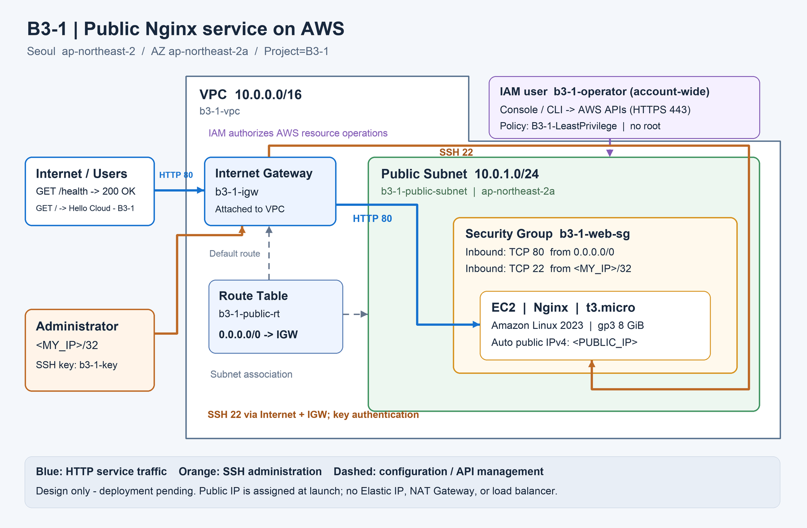

# Codyssey B3-1 — AWS VPC + EC2 + Nginx

서울 리전(ap-northeast-2)에 VPC와 퍼블릭 서브넷을 구성하고 EC2의 Nginx 웹 서비스를 인터넷에서 검증하는 미션이다. 설정의 기준은 [infra/config.env](infra/config.env)이며, 인프라 생성·검증·삭제 스크립트와 제출 증빙 안내를 함께 제공한다.

> 현재 상태: 실제 AWS 배포·외부 접속 검증·삭제를 아직 실행하지 않았다. 아래 성공 조건은 기대값이며 실측 결과가 아니다. `<...>`와 “배포 후 채움”은 배포자가 실제 값으로 교체한다. 로그와 스크린샷은 아직 없다.

## 디렉터리 구조

```text
.
├── README.md
├── infra/
│   ├── config.env              # 리전, CIDR, 타입, 키 경로 등 공통 설정
│   ├── iam-policy.json         # B3-1-LeastPrivilege 정책 원문
│   └── user-data.sh            # Nginx 설치 및 /, /health 설정
├── scripts/
│   ├── provision.sh            # 리소스 생성
│   ├── verify.sh               # 리소스 및 외부 HTTP 검증
│   └── cleanup.sh              # 미션 리소스 정리
├── docs/
│   ├── architecture.png
│   ├── diagram/draw_architecture.py  # PNG 재생성 소스(Pillow)
│   ├── troubleshooting.md
│   └── cleanup-checklist.md
├── screenshots/                # 배포 후 생성; 현재 스크린샷 없음
└── .b3-1-state                 # provision 실행 후 생성되는 리소스 기록; 현재 배포 기록 없음
```

## 구성과 트래픽 흐름



그림은 설계도이며 실배포 화면이 아니다. 모든 미션 리소스의 태그는 `Project=B3-1`이다.

| 구성 요소 | 설정 |
| --- | --- |
| VPC | `b3-1-vpc`, `10.0.0.0/16` |
| Public Subnet | `b3-1-public-subnet`, `10.0.1.0/24`, `ap-northeast-2a` |
| Internet Gateway | `b3-1-igw`, 위 VPC에 연결 |
| Route Table | `b3-1-public-rt`, 위 서브넷에 연결, `0.0.0.0/0 → IGW` |
| Security Group | `b3-1-web-sg`, HTTP TCP 80 `0.0.0.0/0`, SSH TCP 22 `<MY_IP>/32` |
| EC2 | Amazon Linux 2023, `t3.micro`, EBS `gp3` 8 GiB, 키페어 `b3-1-key` |
| 공개 주소 | 시작 시 자동 할당 퍼블릭 IPv4; Elastic IP 미사용 |
| 웹 서버 | Nginx, `GET /`에 `Hello Cloud - B3-1`, `GET /health`에 HTTP 200과 `OK` |

사용자의 HTTP 요청은 인터넷 → Internet Gateway → 퍼블릭 IPv4가 연결된 EC2 네트워크 인터페이스 → Security Group의 TCP 80 허용 → Nginx 순서로 도달한다. 응답은 서브넷 Route Table의 `0.0.0.0/0 → IGW` 경로를 이용한다. Route Table은 패킷이 통과하는 서버가 아니라 경로를 결정하는 설정이다.

IGW는 VPC와 인터넷을 연결한다. 서브넷에 IGW 기본 경로가 있어야 인터넷 방향 경로가 성립하고, EC2에는 인터넷에서 도달할 퍼블릭 IPv4가 필요하다. SG는 도착한 트래픽 중 허용할 포트와 소스를 제한한다. 이 조건 중 하나가 빠지면 퍼블릭 서브넷이라는 이름만으로 인터넷 접속이 되지 않는다. 관련 동작은 [AWS Internet Gateway 문서](https://docs.aws.amazon.com/vpc/latest/userguide/VPC_Internet_Gateway.html)를 참고한다.

관리자의 SSH도 인터넷과 IGW를 거쳐 같은 EC2 퍼블릭 IP의 TCP 22로 도달한다. 현재 관리자 공인 IPv4 `/32`와 `b3-1-key` 개인키를 모두 충족해야 한다. SSH를 `0.0.0.0/0`에 열거나 전체 포트를 허용하지 않는다. 자동 퍼블릭 IP는 중지 후 시작 시 바뀔 수 있으므로 매번 현재 주소를 확인한다.

## Security Group과 IAM, 최소권한

| 구분 | 제어 대상 | 이 미션의 적용 |
| --- | --- | --- |
| Security Group | EC2 네트워크 트래픽 | 인바운드 TCP 80만 전체 IPv4 허용, TCP 22는 현재 내 공인 IPv4 `/32`만 허용; 전체 포트 인바운드 규칙 없음 |
| IAM | 누가 AWS API로 어떤 리소스 작업을 수행하는지 | 루트 계정 대신 `b3-1-operator`, 커스텀 `B3-1-LeastPrivilege`만 부착 |
| SSH 키페어 | EC2 운영체제 로그인 인증 | `b3-1-key`, 개인키 로컬 보관, 계정 `ec2-user` |

IAM을 허용해도 SG의 포트가 열리지 않고, SG가 열려도 AWS API 생성·삭제 권한이 생기지 않는다. EC2에 IAM 역할이나 S3/RDS 접근 권한을 부여할 필요도 없다.

정책 원문은 [infra/iam-policy.json](infra/iam-policy.json)이다. 현재 정책은 서울 리전의 EC2 조회와 네트워크·컴퓨트 생명주기 작업, Amazon Linux AMI 조회용 제한된 SSM 파라미터 읽기, STS 호출 주체 확인과 권한 오류 디코딩을 허용한다. EC2 실행 타입 제한에는 `t2.micro`와 `t3.micro`가 포함되지만 실제 설정은 `t3.micro`이다. `AdministratorAccess`, S3/RDS 등 무관 서비스 권한은 부착하지 않는다.

일부 EC2 액션은 `Resource: "*"`, 조회는 `ec2:Describe*`로 허용되어 있다. 따라서 이것은 미션 액션·리전 중심 제한이며 `Project=B3-1` 태그나 특정 VPC만을 강제하는 완전한 리소스별 제한은 아니다. 태그는 식별·삭제 범위를 확인하는 기준이다. IAM 사용자·정책 생성/부착, IAM 액세스키 상태 변경, ELB/RDS 감사, Billing 조회는 이 운영 정책에 포함하지 않으며 별도 권한을 가진 비루트 관리 주체가 수행한다.

## 사전 준비

1. AWS CLI v2, Bash, curl, SSH 클라이언트를 준비한다. AWS 리전은 서울 `ap-northeast-2`를 사용한다.
2. 기존의 권한 있는 비루트 IAM 관리 주체가 IAM 사용자 `b3-1-operator`를 생성하고 `Project=B3-1` 태그를 지정한다. `infra/iam-policy.json`으로 고객 관리형 정책 `B3-1-LeastPrivilege`를 만든 뒤 이 정책 하나만 연결한다. 그룹·인라인 정책 등 다른 경로로 `AdministratorAccess`가 부여되어 있지 않은지도 확인한다.
3. 콘솔을 사용할 경우 해당 IAM 사용자 로그인과 MFA를 준비한다. CLI용 액세스키는 안전하게 전달받아 로컬 AWS 자격 증명 저장소에만 설정한다. 키·토큰·개인키를 저장소나 스크린샷에 넣지 않는다.
4. 다음 명령으로 운영 사용자 프로필을 설정한다. `<ACCOUNT_ID>`는 실제 AWS 계정 ID로 교체한다.

```bash
aws configure --profile b3-1-operator
# AWS Access Key ID / Secret Access Key: 발급받은 값 입력
# Default region name: ap-northeast-2
# Default output format: json
export AWS_PROFILE=b3-1-operator
aws sts get-caller-identity --region ap-northeast-2
# 확인 기준: arn:aws:iam::<ACCOUNT_ID>:user/b3-1-operator (실측 아님)
```

IAM 관리 주체의 정책 생성·부착 명령 예시다. 실제 계정·정책 ARN을 입력하고, 이미 존재하는 정책은 새로 중복 생성하지 않는다. `<IAM_ADMIN_PROFILE>`은 권한 있는 비루트 관리자 프로필 이름으로 교체한다. 이 명령을 실행하려고 운영 사용자에게 IAM 관리 권한을 추가하지 않는다.

```bash
aws --profile '<IAM_ADMIN_PROFILE>' iam create-user --user-name b3-1-operator \
  --tags Key=Project,Value=B3-1 --region ap-northeast-2
aws --profile '<IAM_ADMIN_PROFILE>' iam create-policy --policy-name B3-1-LeastPrivilege \
  --policy-document file://infra/iam-policy.json \
  --tags Key=Project,Value=B3-1 --region ap-northeast-2
aws --profile '<IAM_ADMIN_PROFILE>' iam attach-user-policy --user-name b3-1-operator \
  --policy-arn 'arn:aws:iam::<ACCOUNT_ID>:policy/B3-1-LeastPrivilege' \
  --region ap-northeast-2
aws --profile '<IAM_ADMIN_PROFILE>' iam list-attached-user-policies --user-name b3-1-operator --region ap-northeast-2
aws --profile '<IAM_ADMIN_PROFILE>' iam list-user-policies --user-name b3-1-operator --region ap-northeast-2
aws --profile '<IAM_ADMIN_PROFILE>' iam list-groups-for-user --user-name b3-1-operator --region ap-northeast-2
```

키페어는 `scripts/provision.sh`가 서울 리전에 `b3-1-key` 이름으로 새로 생성한다. 수동으로 같은 이름의 키를 미리 만들면 충돌하므로 생성 전 기존 키 유무를 확인한다. 개인키 경로는 `infra/config.env`의 `KEY_PATH`(기본 `~/.ssh/b3-1-key.pem`)다. 기존 키페어가 있는데 해당 개인키가 없으면 그 키로 SSH할 수 없으므로 다른 실습에 쓰는 키를 덮어쓰지 말고 소유 관계부터 확인한다. 스크립트는 개인키 생성 후 권한을 400으로 설정하며, 로컬 KEY_PATH 파일이 이미 존재하면 덮어쓰지 않고 중단한다. 재배포 시에는 기존 키의 용도와 보관 여부를 확인한 뒤 정리한다.

```bash
aws ec2 describe-key-pairs --key-names b3-1-key --region ap-northeast-2
# 배포 전 키가 아직 없으면 InvalidKeyPair.NotFound가 날 수 있다.
curl -4 -fsS https://checkip.amazonaws.com
# 반환된 현재 공인 IPv4를 /32로 제한; VPN·네트워크 변경 후 재확인
```

## 실행 절차

저장소 루트에서 아래 순서로 실행한다. 아래는 실행 안내이며 이 문서 작성 과정에서는 AWS 명령을 실행하지 않았다. 스크립트 실행 전에 원문과 공통 설정을 검토한다.

```bash
export AWS_PROFILE=b3-1-operator
bash scripts/provision.sh
bash scripts/verify.sh
# 검증과 증빙 저장을 마친 뒤
bash scripts/cleanup.sh
```

생성 후 `.b3-1-state`와 `Project=B3-1` 태그를 함께 대조한다. `verify.sh`의 PASS 출력과 함께 아래 외부 curl 원문의 HTTP 상태 코드와 본문을 직접 확인한다. EC2의 running 상태만으로 Nginx 준비가 끝난 것은 아니므로 user-data 완료와 HTTP 응답을 확인한다. 실패하면 [트러블슈팅](docs/troubleshooting.md)을 따라 점검한다. 정리 절차와 종료 증빙은 [삭제 체크리스트](docs/cleanup-checklist.md)를 따른다.

## 외부 접속 검증과 제출 증빙

선택 방식: (B) GET http://<PUBLIC_IP>/health

주 검증은 EC2 외부의 로컬 PC에서 `/health`를 요청하는 것이다. 기대 조건은 HTTP 상태 코드 `200`, 본문 `OK`이며 아직 측정하지 않았다. (A) 브라우저에서 루트 페이지를 열어 `Hello Cloud - B3-1` 문구를 보는 검증을 보조로 수행한다. EC2 내부 localhost 성공만으로 외부 인터넷 접속 성공을 대체하지 않는다.

| 접속 정보 | 실제 값 |
| --- | --- |
| 배포 일시 / 확인자 | `<DEPLOYED_AT>` / `<OPERATOR>` — 배포 후 채움 |
| EC2 Instance ID | `<INSTANCE_ID>` — 배포 후 채움 |
| 현재 퍼블릭 IP | `<PUBLIC_IP>` — 배포 후 채움 |
| 내 공인 IPv4 / SSH 허용 소스 | `<MY_IP>/32` — 배포 후 채움 |
| 주 검증 URL | `http://<PUBLIC_IP>/health` — 배포 후 채움 |
| 보조 URL | `http://<PUBLIC_IP>/` — 배포 후 채움 |
| 외부 확인 결과 | `<HTTP_STATUS>`, `<RESPONSE_BODY>`, `<CHECKED_AT>` — 배포 후 채움 |

```bash
# 로컬 PC: <PUBLIC_IP>를 실제 주소로 교체
curl -v --connect-timeout 5 --max-time 15 'http://<PUBLIC_IP>/health'
curl -i --connect-timeout 5 --max-time 15 'http://<PUBLIC_IP>/'
ssh -i ~/.ssh/b3-1-key.pem ec2-user@<PUBLIC_IP>
# EC2 내부
curl -i http://127.0.0.1/health
sudo nginx -t
sudo systemctl status nginx --no-pager
```

| 증빙 위치 | 담을 내용 | 현재 상태 |
| --- | --- | --- |
| `screenshots/health-check.png` | 외부 `/health` URL, HTTP 200, OK, 확인 시각 | 아직 없음 — 배포 후 채움 |
| `screenshots/browser.png` | 브라우저 주소 표시줄과 루트 페이지 문구 | 아직 없음 — 배포 후 채움 |
| `screenshots/curl-localhost.png` | EC2 내부 localhost 응답과 Nginx 상태 | 아직 없음 — 배포 후 채움 |
| `screenshots/network.png` | VPC·서브넷·IGW 연결·RT 기본 경로 | 아직 없음 — 배포 후 채움 |
| `screenshots/security-group.png` | 80 전체 IPv4 / 22 내 IP만 허용 | 아직 없음 — 배포 후 채움 |
| `screenshots/iam-policy.png` | 운영 사용자와 연결된 커스텀 정책 | 아직 없음 — 배포 후 채움 |
| `screenshots/cleanup.png` | 삭제 후 잔여 리소스 조회 결과 | 아직 없음 — 배포 후 채움 |
| `screenshots/billing.png` | Billing Dashboard 확인 시각과 사용 내역 | 아직 없음 — 배포 후 채움 |

실제 원문 로그: `<VERIFY_LOG — 배포 후 채움>`. 스크린샷을 저장할 때 자격 증명은 포함하지 않는다.

## 요구사항 체크리스트

| 요구사항 | 어떻게 충족하는가 | 증빙 위치 / 상태 |
| --- | --- | --- |
| 서울 리전과 AZ | `ap-northeast-2`, `ap-northeast-2a` | `infra/config.env`; 실배포 증빙은 `screenshots/network.png`에 배포 후 채움 |
| VPC와 퍼블릭 서브넷 | `10.0.0.0/16`, `10.0.1.0/24` | `docs/architecture.png`, `scripts/provision.sh`; 실측 미완료 |
| 인터넷 연결 | IGW 부착 + 서브넷 RT 연결 + 기본 경로 + 자동 퍼블릭 IP | `screenshots/network.png` — 배포 후 채움 |
| SG 제한 | TCP 80 전체 IPv4, TCP 22 내 IP `/32`, 전체 포트 허용 없음 | `screenshots/security-group.png` — 배포 후 채움 |
| EC2와 저장소 | AL2023, `t3.micro`, `gp3` 8 GiB, `b3-1-key` | `infra/config.env`, `scripts/provision.sh`; 실측 미완료 |
| Nginx 서비스 | `/` 고정 문구, `/health` 200 OK | `infra/user-data.sh`, `screenshots/curl-localhost.png` — 배포 후 채움 |
| 외부 검증 B + 보조 A | 외부 `/health`와 브라우저 `/` 확인 | `screenshots/health-check.png`, `screenshots/browser.png` — 배포 후 채움 |
| IAM 최소권한과 루트 미사용 | `b3-1-operator`에 커스텀 정책 하나, AdministratorAccess 없음 | `infra/iam-policy.json`, `screenshots/iam-policy.png` — 배포 후 채움 |
| 식별 태그 | 모든 미션 리소스 `Project=B3-1` | 태그 조회 원문 — 배포 후 채움 |
| 장애 대응 | HTTP, SSH, IAM 오류의 가설·명령·조치·기록 서식 | `docs/troubleshooting.md`; 재현 기록 미작성 |
| 비용 정리 | 자동 스크립트와 수동 삭제·잔여 조회·과금 확인 | `docs/cleanup-checklist.md`, `screenshots/cleanup.png` — 배포 후 채움 |

## 대표 과금 요인

EC2 실행 시간, EBS gp3 용량과 추가 성능 설정, 퍼블릭 IPv4 사용 시간, 인터넷 데이터 전송 등이 과금 요인이다. 자동 할당 퍼블릭 IPv4도 과금 대상이 될 수 있으므로 EIP를 쓰지 않는다고 주소 비용이 없어지는 것은 아니다. EC2를 중지해도 남은 EBS는 별도로 비용이 발생할 수 있다. 실제 단가와 계정별 무료 제공 조건은 [EC2 On-Demand](https://aws.amazon.com/ec2/pricing/on-demand/), [EBS 요금](https://aws.amazon.com/ebs/pricing/), [VPC 퍼블릭 IPv4 요금](https://aws.amazon.com/vpc/pricing/)에서 배포 시 확인한다. 이 문서는 비용이나 프리 티어 무료 여부를 보장하지 않는다.

NAT Gateway, ELB, RDS, Elastic IP는 이 설계에서 생성하지 않는다. 사용 후에는 인스턴스 종료뿐 아니라 EBS·주소·다른 리전 잔여 리소스와 Billing Dashboard까지 확인한다. 과금 수치는 `<BILLING_RESULT — 배포 후 채움>`이다.

## 보너스와 자체 점검

보너스 미수행: HTTPS/도메인, 로드 밸런서, Auto Scaling, 다중 AZ 고가용성 등 추가 구성은 구현하지 않았다. 기본 미션 설계와 스크립트만 준비했으며 실제 AWS 배포 성공을 주장하지 않는다.

문서 자체 점검: 실측 IP·리소스 ID·로그·스크린샷·과금 수치를 만들어 넣지 않았다. `200`, `OK`, `Hello Cloud - B3-1`은 요구된 성공 조건이며 관측 결과가 아니다. 실제 증빙과 체크리스트 완료 표시는 배포·검증·삭제 후 채운다.

정적 산출물 확인: `docs/architecture.png`는 1800×1180 PNG이며 직접 열어 텍스트·영역 경계·HTTP 80/SSH 22 흐름을 확인했다. 이는 다이어그램 검수 결과이며 AWS 동작 검증 결과가 아니다.
